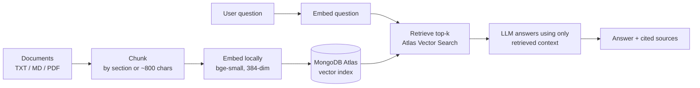

# Grounded Q&A Assistant (RAG on MongoDB Atlas Vector Search)

**Ask questions in plain English and get answers drawn only from your own documents, with the sources listed.**

## The problem

LLMs answer confidently even when they are wrong. For customer-facing questions like refund rules or warranty terms, an invented answer is a real risk. RAG grounds each answer in your own documents: the model gets only the relevant passages and must say "I don't know" when they don't hold the answer.

## Who it's for

- **Teams putting an AI assistant in front of customers** who need answers tied to written policy. The demo uses sample refund, shipping, support and warranty policies.
- **Students and knowledge workers** who want to question their own material. It reads `.txt`, `.md` and `.pdf` files.

## Product decisions and trade-offs

| Decision | Why | Trade-off |
|---|---|---|
| **Local embeddings** (Sentence Transformers, `BAAI/bge-small-en-v1.5`, 384 dimensions) instead of a paid embedding API | No per-call cost, and full documents never go to an embedding vendor (only the retrieved passages are sent to the LLM) | Model downloads on first run; a small model may retrieve less precisely |
| **Upgraded from `all-MiniLM-L6-v2` to `bge-small`**, adding a search instruction to questions only | A stronger retrieval model at the same 384 dimensions, so the index stayed the same | Questions and documents are encoded differently, which must stay consistent |
| **MongoDB Atlas Vector Search** instead of a separate vector database | Text, metadata and vectors live in one collection and one query | Requires Atlas (or another deployment with `$vectorSearch`) |
| **Answers come with sources** | The answer cites source titles; every retrieved passage is listed with its similarity score | Longer output, but auditable |
| **Strict grounding prompt at temperature 0** | Uses only the supplied context and admits when documents don't cover a question | Declines more often instead of guessing |
| **Chunking by structure** | Markdown splits by `##` section with title and heading kept on each chunk; other files use ~800-character chunks with 100-character overlap | Fixed-size splits can cut sentences; overlap stores some text twice |
| **Swappable LLM provider** | An OpenAI-compatible client points at Gemini, so the model is a setting (an earlier version used `gpt-4o-mini`) | Answer quality depends on the configured model |

## Key features

- Command-line Q&A that returns an answer plus scored sources
- Folder ingestion for TXT, Markdown and PDF, with each chunk tagged by source file
- Re-ingesting a file replaces only that file's chunks
- A seeded sample knowledge base for a quick demo
- Clear errors when the database or search index isn't ready
- Credentials kept in environment settings, never in source

## How it works

## Tech stack

Python · MongoDB Atlas Vector Search · PyMongo · Sentence Transformers (BAAI bge-small-en-v1.5) · Google Gemini via the OpenAI-compatible SDK · pypdf · python-dotenv

## What's next

- A Streamlit interface that shows source snippets next to each answer
- Page numbers and access-control metadata on each chunk
- Compare vector retrieval with keyword search

## About me

**Cheran Seripally**: Product strategy and development | MS ITM @ UT Dallas | [linkedin.com/in/cheran-seripally](https://linkedin.com/in/cheran-seripally)

---

© 2026 Cheran Seripally. All rights reserved. Source code is private; available to recruiters on request.
